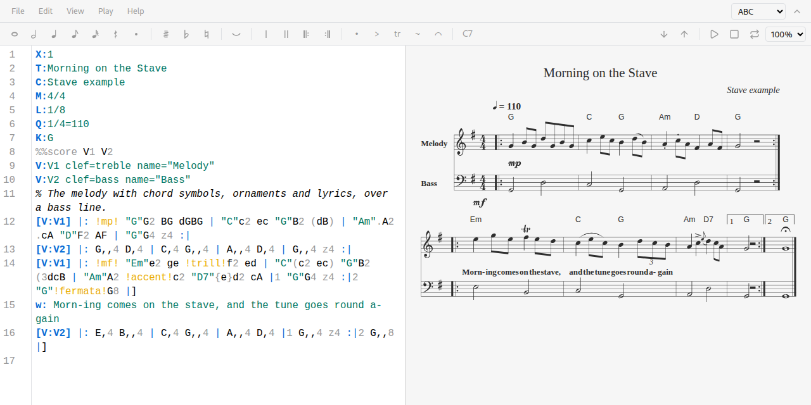
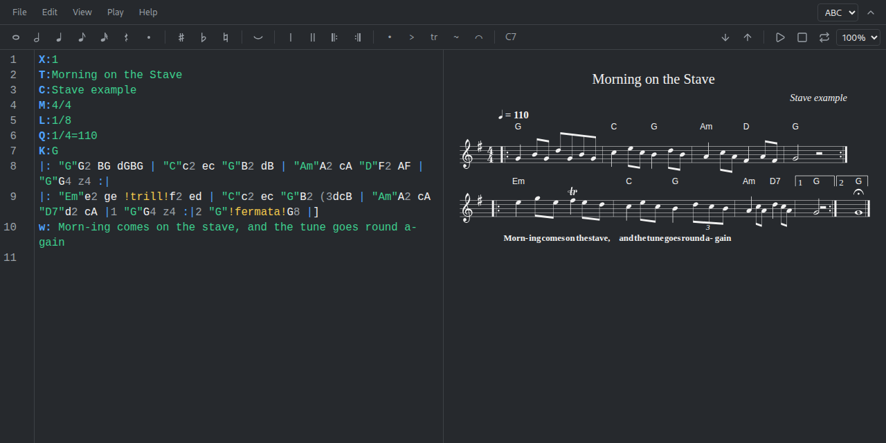

# StandardNotes Stave

[](https://github.com/Esl1h/StandardNotes-Stave/actions/workflows/ci.yml)
[](https://github.com/Esl1h/StandardNotes-Stave/actions/workflows/github-code-scanning/codeql)
[](https://github.com/Esl1h/StandardNotes-Stave/actions/workflows/coverage.yml)
[](https://scorecard.dev/viewer/?uri=github.com/Esl1h/StandardNotes-Stave)
[](https://github.com/Esl1h/StandardNotes-Stave/releases/latest)
[](LICENSE)

A music notation and tablature editor for [Standard Notes](https://standardnotes.com), a free, open-source, end-to-end encrypted notes app. You write music as text (ABC, alphaTex) and Stave draws it next to the source, plays it and exports it. The note keeps only the text, so it stays readable and useful without the plugin.

Stave is in early development: ABC and alphaTex work end to end, and more is coming (see [Roadmap](#roadmap)).





## Features

### ABC

- Live rendering with [abcjs](https://www.abcjs.net) as you type, with parser errors underlined in the source at their line and column
- A toolbar for durations, rests, dots, accidentals, ties, bar lines, repeats, ornaments and chord symbols; it writes ABC at the cursor, in the unit note length of the tune
- Click a note in the rendering to select it in the source; the note at the cursor is highlighted in the rendering
- Playback with a cursor that follows the notes, loop and speed from 50% to 150%, on a piano sampled from the Fluid R3 GM SoundFont that ships with the plugin
- Transpose the source a semitone at a time (key signature included)
- Export SVG, PNG and MIDI, or download the `.abc` source
- Syntax highlighting, completion of header fields, and a cheat sheet in the Help menu

### alphaTex

- Standard notation and guitar tablature with [alphaTab](https://www.alphatab.net), several tracks with their own tunings, shown as score, tab or both (View menu)
- Parser errors underlined in the source at their line and column; the last good rendering stays while you fix them
- A toolbar for durations, rests, dots, ties, bar lines, repeats, chord symbols and techniques (bend, slide, hammer-on, palm mute, harmonic, vibrato, dead note); sharp and flat move a fret up or down
- Click a beat in the rendering to select it in the source; the beat at the cursor is marked in the rendering
- Playback with alphaTab's synthesizer and the Sonivox SoundFont that ships with the plugin, with a cursor, loop, speed, and mute or solo per track (Play menu)
- Transpose the source a semitone at a time: frets, pitch names, key signature and chord symbols
- Export SVG (with the music font inside), PNG, MIDI and Guitar Pro 7, or download the `.atex` source
- Syntax highlighting, completion of metadata tags, and a cheat sheet in the Help menu

### Editor

- Source and rendering side by side, stacked, or one at a time, with the panes in either order
- A menu bar (File, Edit, View, Play, Help) and a contextual toolbar, both collapsible, with the notation of the note always visible
- Notation engines behind one interface: each engine detects its own text, offers a template and a cheat sheet, and turns toolbar actions into its syntax
- Renderer errors shown inline in the source, with line and column
- Keyboard shortcuts for durations, rests, bar lines, playback, transposition and the layout (Help, Keyboard shortcuts)
- Every Standard Notes theme, through the theme variables only
- Locked notes open read-only
- Phones get collapsed bars and stacked panes
- Layout preferences are kept per editor in Standard Notes, never in the note

## Installation

1. Run the Standard Notes web or desktop app.
2. Click the **Preferences** (gear) icon.
3. Select **Plugins** in the Preferences menu.
4. Scroll to the bottom and paste this URL into the **Install Custom Plugin** box:

   ```
   https://esli.cafe/StandardNotes-Stave/ext.json
   ```

5. Confirm the installation.
6. Create a new note, open the **Editor** menu and pick **Stave**.

The app checks that URL for updates, so new releases arrive on their own. Each [release](https://github.com/Esl1h/StandardNotes-Stave/releases/latest) also carries the packaged build as `extension.zip`.

### Self-hosting

The hosted build is plain static files, so it can be served from anywhere. Unzip `extension.zip` from a release (or run `npm run build` and take `build/`), serve the files over HTTPS with CORS enabled, and change `url`, `download_url` and `latest_url` in `ext.json` to your host. Install your `ext.json` URL as above. To keep both the hosted and your copy installed, also change `identifier`.

## Verifying a release

Each release attaches a `SHA256SUMS` file and a build provenance attestation next to `extension.zip`, the package the desktop app installs. To check a downloaded zip, run in the folder that holds both files:

```
sha256sum -c SHA256SUMS
gh attestation verify extension.zip -R Esl1h/StandardNotes-Stave
```

The second command confirms that the zip was built by this repository's release workflow from the tagged commit. Releases are immutable: once published, their tag and files cannot be changed.

## Note format

The note is the notation source, nothing else. Stave picks the engine from the text: ABC when the first line that is not empty starts with `X:`, alphaTex when lines start with a backslash tag such as `\title`. An empty note offers the engines with a template each. Switching the engine of a written note asks first and never converts the text.

An ABC note is plain [ABC 2.1](https://abcnotation.com/wiki/abc:standard:v2.1), so it opens in any ABC tool:

```
X:1
T:Morning on the Stave
M:4/4
L:1/8
K:G
|: "G"G2 BG dGBG | "C"c2 ec "G"B2 dB | "Am"A2 cA "D"F2 AF | "G"G4 z4 :|
```

An alphaTex note is plain [alphaTex](https://www.alphatab.net/docs/alphatex/introduction), the text format of alphaTab:

```
\title "Morning Riff"
\tempo 96
\track "Guitar"
\staff {score tabs}
0.6.8 0.6 3.6 0.6 5.6.4 3.6.8 5.6 | (0.6 2.5 2.4).4{ch "E5"} 7.3{b (0 4)}.4 r.2
```

[examples/](examples) has a note for each notation, used by the tests and the screenshots.

## Compatibility

Tested with the Standard Notes web app and the desktop app. The mobile apps are supported through the same component API, with a layout for narrow screens.

## Privacy and network

Everything is stored inside your Standard Notes note, so it is encrypted with the rest of your data. The editor has no telemetry, no analytics and no network access of its own: renderers, fonts and sounds ship with the build and nothing is fetched from a CDN. The page's Content Security Policy allows scripts and connections only from the plugin's own origin, and workers only from blobs the page makes itself (alphaTab's player, see [record 15](docs/adr/0015-alphatab-in-the-standard-notes-iframe.md)).

## Development and running locally

1. (Optional) Fork this repo on GitHub.
2. [Clone](https://docs.github.com/en/repositories/creating-and-managing-repositories/cloning-a-repository) this repo or your fork.
3. Run `cd StandardNotes-Stave` and then `npm install` to install all dependencies.

### Testing inside your local Standard Notes app

The editor waits for Standard Notes to send the note, so it needs a host: the Standard Notes app, or the fake host of the e2e suite.

1. Run `npm run build` to build the app, then:

```
npm run server-cors
```

2. In Standard Notes, follow the Installation steps above but paste:

```
http://localhost:3000/ext.dev.json
```

The dev extension uses a separate identifier (`Stave (Dev)`) so it does not clash with the hosted one.

3. When you're done, press `Ctrl + C` to shut down the server.

If you run into issues, please refer to the [Standard Notes instructions for local plugin setup](https://standardnotes.com/help/plugins/local-setup).

### Checks

CI runs these on every push and pull request; run them before opening a PR:

```
npm run typecheck       # TypeScript
npm run lint            # ESLint
npm run format:check    # Prettier
npm test                # unit, component and property tests (Vitest, fast-check)
npm run build           # production build
npm run check:build     # no unreferenced file in build/
npm run check:lockfile  # no dependency from git
npm run size            # bundle size, initial load and lazy chunks
npm run e2e             # end to end tests (Playwright)
```

Run `npx playwright install chromium` once before the first `npm run e2e`. The e2e suite builds the plugin and drives it through a fake Standard Notes host (`e2e/snHost.js`), including a throttled CPU (slow mobile WebView) and the opaque origin of the mobile app. CI also builds the plugin with Yarn 3 from a clean copy, as the [community plugins repository](https://github.com/standardnotes/plugins) would (`scripts/community-build.sh`).

### Releases

The extension is hosted on GitHub Pages from the `gh-pages` branch, served at `https://esli.cafe/StandardNotes-Stave/`. To cut a release:

1. On a branch, run `npm run version:bump X.Y.Z`, which writes the version to `package.json`, `package-lock.json`, `public/package.json`, `public/ext.json` (with its `download_url`) and `public/ext.dev.json`, then `npm run changelog -- --tag vX.Y.Z`, which adds the section for the new version to `CHANGELOG.md` from the commits since the last tag. Commit both as `chore(release): vX.Y.Z` and merge the pull request.
2. On `main`, push the tag:

```
git tag -a vX.Y.Z -m vX.Y.Z && git push origin vX.Y.Z
```

The `Release` workflow fails unless the tag matches every version file. It runs the checks, attaches `extension.zip` (the package the desktop app installs) with `SHA256SUMS` and a provenance attestation to the GitHub release, writes the release notes with git-cliff and publishes the hosted build to Pages. The app finds the update by comparing the version in the `ext.json` at `latest_url`.

## Roadmap

1. ABC with abcjs: rendering, toolbar, playback, click to source, export (done)
2. alphaTex with alphaTab: notation and tablature, techniques, playback with tracks, export (done)
3. Engine detection and switching, the full menu, mobile polish
4. Verovio as a higher quality renderer for ABC
5. Import of MusicXML, Guitar Pro and Capella files into alphaTex, print and PDF
6. ChordPro

The decisions behind the project are recorded in [docs/adr](docs/adr/README.md).

## Credits and license

- Built on [Standard Notes](https://standardnotes.com) and its [component relay](https://github.com/standardnotes/component-relay) (AGPL-3.0), copied into `src/vendor/`
- Editor: [CodeMirror](https://codemirror.net) (MIT); icons: [Lucide](https://lucide.dev) (ISC)
- ABC rendering and playback: [abcjs](https://github.com/paulrosen/abcjs) (MIT)
- alphaTex rendering and playback: [alphaTab](https://github.com/CoderLine/alphaTab) (MPL-2.0), with the [Bravura](https://github.com/steinbergmedia/bravura) music font (SIL OFL 1.1) and the Sonivox SoundFont (Apache-2.0), both shipped with their licenses in `font/` and `soundfont/`
- Piano samples: the Fluid R3 GM SoundFont (CC BY 3.0), rendered to MP3 by [midi-js-soundfonts](https://github.com/paulrosen/midi-js-soundfonts) (MIT); see `public/soundfont/README.md`
- `THIRD_PARTY_LICENSES.md`, shipped next to the built page, lists every bundled dependency with its license
- Licensed under [AGPL-3.0](LICENSE) or later
